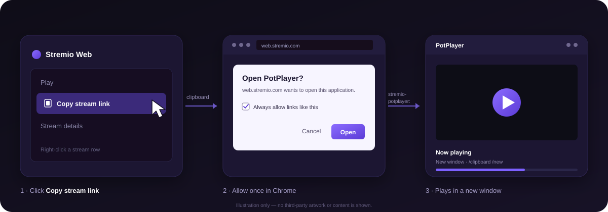

# Stremio Web → PotPlayer

[](LICENSE)


A tiny Chrome extension that hands Stremio Web's **Copy stream link** action to
PotPlayer on Windows. One click, Chrome's **"Open PotPlayer?"** prompt, and the
stream opens in a new PotPlayer window.

No helper executable, no native messaging, no admin rights.



## Features

- One click from a stream row — no copy/paste dance.
- Matches current and historical localized **Copy stream link** labels in 50+
  locales, generated from
  [Stremio/stremio-translations](https://github.com/Stremio/stremio-translations).
- **Shift-click or Alt-click copies without launching PotPlayer.**
- Chrome's familiar external-protocol prompt; tick **Always allow** once and it
  won't ask again.
- PotPlayer reads the link from the clipboard itself (`/clipboard`), so the URL
  never passes through Chrome's URL parser.
- **No clipboard-read permission.** The extension never calls
  `navigator.clipboard.readText()`.
- No `chrome.*` API permissions at all — only access to `web.stremio.com`.
- Per-user install (`HKCU`), no administrator rights.
- No network requests, telemetry, or remote code.

## How it works

1. You click **Copy stream link** in Stremio Web. Stremio itself calls
   `navigator.clipboard.writeText(streamUrl)`.
2. The extension runs in the page's MAIN world and wraps
   `Clipboard.prototype.writeText`. A click on the localized copy item arms it
   for 1.5 seconds.
3. When Stremio writes an `http(s)` URL during that window, the extension waits
   for the write promise to resolve, then opens `stremio-potplayer:go`.
4. Chrome shows **"Open PotPlayer?"**. After you allow it the first time, it
   launches the registered handler directly.
5. Windows runs:

   ```
   "…\PotPlayerMini64.exe" /clipboard /new
   ```

6. PotPlayer reads the URL from the clipboard and opens it in a new window.

There is no clipboard polling and no stale read: the extension only observes the
exact text Stremio is already writing, and only after that write succeeds. The
extension makes no network requests and does not download or proxy anything.

The extension ignores Stremio's in-player menu (`#/player`), so copying a link
while watching does not launch a second player.

Stremio writes the URL to the Windows clipboard. If Windows Clipboard History or
cross-device sync is enabled, Windows may retain or sync it independently of the
extension — see [Security](#security).

## Install

**Requirements:** Windows 10/11, Chrome/Chromium 111+ (for MAIN-world content
scripts), and 64-bit PotPlayer.

### 1. Download and extract

Download the latest `stremio-potplayer-*.zip` from this repository's
[Releases](../../releases) and extract it to a permanent folder, for example
`C:\Tools\stremio-potplayer`.

Keep that folder: **Load unpacked** runs the extension from it, so it must stay
on disk.

### 2. Register the protocol

Double-click [`install\install.cmd`](install/install.cmd). It finds PotPlayer
and writes a per-user `stremio-potplayer:` handler.

Windows may warn that the `.cmd` came from the internet because it is unsigned.
Choose **More info → Run anyway** only if you downloaded the zip from this
repository's Releases.

If PotPlayer lives in a custom folder, pass the executable explicitly:

```bat
install\install.cmd -PotPlayerPath "D:\Players\PotPlayer\PotPlayerMini64.exe"
```

To preview the command without changing the registry:

```powershell
powershell -ExecutionPolicy Bypass -File install\install.ps1 -DryRun
```

### 3. Load the extension

1. Open `chrome://extensions`.
2. Enable **Developer mode** (top right).
3. Click **Load unpacked** and select the [`extension`](extension) folder.

### 4. Restart Chrome

Open `chrome://restart` (or quit Chrome completely and reopen). Chrome reads
external-protocol registrations at launch.

## Use

1. Open <https://web.stremio.com> and choose a title.
2. **Right-click a stream row** (or Ctrl+click / long-press) and click
   **Copy stream link**.
3. Chrome shows **"Open PotPlayer?"** — tick **Always allow …** and click **Open**.
4. PotPlayer opens a new window and plays the stream.

After the first **Always allow**, the prompt is skipped. The in-player `···`
menu is intentionally ignored.

To copy a link without launching PotPlayer, hold **Shift** or **Alt** while
clicking **Copy stream link**.

## Security

The protocol handler runs `PotPlayerMini64.exe /clipboard /new`, so it opens
whatever is currently on the Windows clipboard. It cannot tell whether the
invocation came from Stremio or from another program.

- **Only tick Always allow for `web.stremio.com`.** Chrome scopes that permission
  to the site where you ticked it; deny the prompt on every other site.
- Any local program or document can invoke `stremio-potplayer:go` directly,
  without Chrome's prompt.
- Do not copy untrusted paths and then invoke the handler. A UNC path such as
  `\\host\share\x.mkv` can make Windows authenticate to a remote SMB server and
  expose your NTLM hash.
- Stream URLs often contain debrid/addon API tokens. Clear the clipboard after
  copying one if that matters.
- If Windows Clipboard History or cross-device sync is enabled, Windows may
  retain or sync the copied URL. Disable it or clear the entry if that matters.
- A validating launcher that checks for an `http(s)` URL would close these gaps,
  but it would add the helper executable this project intentionally avoids.

## Troubleshooting

| Symptom | Check |
| --- | --- |
| Nothing happens when clicking Copy stream link | Is the extension loaded at `chrome://extensions`? Any errors on its card? Did you restart Chrome after installing the protocol? Check the console for `[PotPlayer launcher]` messages. Remember that the stream-row menu is opened with right-click / Ctrl+click / long-press, not a `···` button. |
| It copies the link but PotPlayer does not open | You may have held Shift or Alt, or clicked the in-player `···` menu. Both are copy-only by design. |
| Chrome never shows the "Open PotPlayer?" prompt | Run `install\install.cmd` again and confirm it ends with **Registered**. Verify the key with `reg query HKCU\Software\Classes\stremio-potplayer\shell\open\command`. |
| The prompt appears every time | Tick **Always allow** in the prompt. The choice is per Chrome profile; incognito won't remember it. |
| The extension says "Couldn't copy the stream link" | Stremio's own `writeText` call was rejected. Check the browser's clipboard permissions, then click **Copy stream link** again. The extension does not fall back to an old clipboard value. |
| PotPlayer opens its Open URL dialog instead of playing | This build relies on PotPlayer's `/clipboard` switch. Open an issue with your PotPlayer version if it doesn't auto-play. |
| Every stream reuses the same PotPlayer window | `/new` may not combine with `/clipboard` on your build. In PotPlayer, open `F5` → **General** → **Multiple instances** and allow multiple instances. |
| "PotPlayer was not found" in the installer | Install 64-bit PotPlayer, or pass `-PotPlayerPath "C:\path\to\PotPlayerMini64.exe"` to `install.cmd`. |
| The extension works in English but not another language | Run `python tools/update-labels.py --source <stremio-translations clone>` and reload the extension. `labels.js` keeps current and historical labels, and the weekly `labels` workflow runs `--check` for upstream changes. |

The extension logs to the page console with the `[PotPlayer launcher]` prefix
(`F12` → Console). `console.info` is visible at the default log level.

## Privacy & permissions

| Access | Why |
| --- | --- |
| `https://web.stremio.com/*` | The content script runs only on Stremio Web. |

The extension requests **no `chrome.*` API permissions**. It does not call
`navigator.clipboard.readText()`, and it does not read or store clipboard
contents. It only inspects the text Stremio passes to its own
`Clipboard.prototype.writeText()` call, locally in the page.

There are no network requests, analytics, or remote scripts. The protocol
handler and the extension both run locally. See [`PRIVACY.md`](PRIVACY.md) for
the full policy.

Stremio writes the stream URL to the Windows clipboard, and that URL may contain
API tokens. If Windows Clipboard History or cross-device sync is enabled,
Windows may retain or sync it independently of the extension. See
[Security](#security).

## Uninstall

1. Run [`install\uninstall.cmd`](install/uninstall.cmd) to remove
   `HKCU\Software\Classes\stremio-potplayer`.
2. Remove the extension from `chrome://extensions`.

## FAQ

### Why not use PotPlayer's built-in `potplayer:` protocol?

PotPlayer already registers `potplayer:`, but Chrome 130+ parses
`potplayer://http://…` as `potplayer://http//…`, which makes PotPlayer report
"file not found" ([Chromium issue 373928202](https://issues.chromium.org/issues/373928202)).
This project sends a constant URL (`stremio-potplayer:go`) and lets PotPlayer
read the real URL from the clipboard, sidestepping the parser entirely.

### Does it work in Edge or Brave?

It should, provided the browser supports MAIN-world content scripts (Chromium
111+) and external protocol handlers. Load it from `edge://extensions` (or the
browser's equivalent) and allow the prompt once.

### Does it support subtitles, titles, or resume position?

Not currently. PotPlayer reads only the URL from the clipboard; the extension
does not pass extra `/sub`, `/title`, or `/seek` switches.

### Why does the extension need clipboard access?

It doesn't. It never reads the clipboard. It observes Stremio's own
`writeText()` call and uses the text Stremio is already copying.

### How are the translations kept up to date?

[`extension/labels.js`](extension/labels.js) is generated from the
`CTX_COPY_STREAM_LINK` key in Stremio's translation files. It keeps both current
labels and **historical labels**, because Stremio Web can run against an older
translation snapshot:

```powershell
git clone https://github.com/Stremio/stremio-translations.git ..\stremio-translations
python tools/update-labels.py --source ..\stremio-translations
```

The generated file is committed. A weekly `labels` workflow runs
`python tools/update-labels.py --check` and fails when Stremio adds or rewords a
label; rerun the command above and commit the result.

## Contributing

Contributions are welcome — see [`CONTRIBUTING.md`](CONTRIBUTING.md). For a
quick start: load the extension unpacked, run the installer in dry-run mode,
and test with content you are allowed to access. If you touch the label matching,
regenerate `labels.js` with the command above.

## Disclaimer

This is an unofficial community project. It is **not affiliated with, endorsed
by, or sponsored by** Stremio or PotPlayer. Stremio and PotPlayer are trademarks
of their respective owners.

This project does not provide, host, download, or distribute any media. It only
hands a URL that is already on your clipboard to a local media player. You are
responsible for using it only with content you are legally allowed to access,
and for complying with copyright law and the terms of service of any service you
use.

The software is provided "as is", without warranty of any kind.

## License

[MIT](LICENSE)
